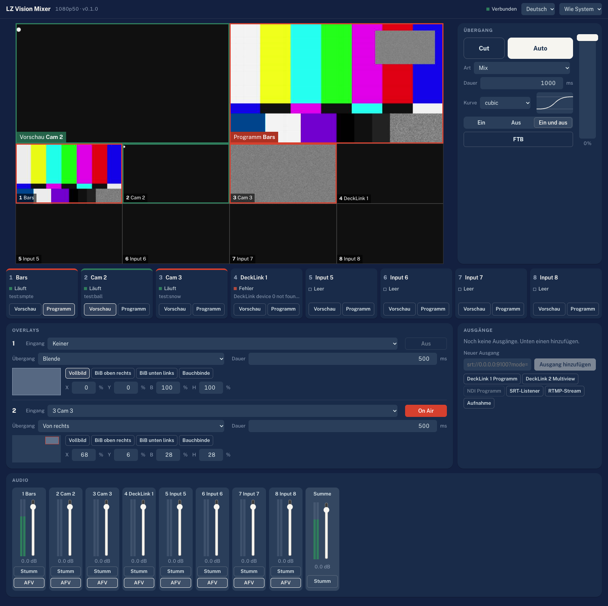

# LZ Vision Mixer

**Software vision mixer in the manner of vMix: eight inputs, preview/programme with eased transitions, overlays, multiview, and outputs to DeckLink SDI, NDI, SRT, RTMP and recording.** Engine in Rust on GStreamer, controlled from the browser, Bitfocus Companion or plain HTTP. macOS, Windows, Linux.



## What it does

- **Eight inputs**, each with its own frame sync: every source is converted to the programme format (scaled with letterbox, frame rate matched) in a pipeline of its own. A source that fails shows black after a second and is retried every three seconds; the programme keeps running.
  - `test:smpte`, `test:bars`, `test:ball`, `test:black`, `test:snow`
  - `decklink:<n>` — DeckLink SDI/HDMI input, mode detected automatically
  - `ndi:<source name>`
  - `srt://…`, `rtmp://…`, `rtsp://…`, `http(s)://…`, `udp://…`
  - `file:<path>` (loops), `image:<path>`
- **Preview / programme** like a hardware mixer: Cut, Auto, T-bar, fade to black. Transitions: cut, mix, dip through black, push left/right, slide left/right, zoom — each with one of eleven easing curves (linear, sine, quad, cubic, quart, quint, expo, circ, back, elastic, bounce; in, out or in-out). The T-bar drives the transition by hand, without a curve. After a transition, programme and preview swap.
- **Two overlays** above the programme (downstream key or picture-in-picture), any input at any position and size, in and out with cut, fade, fly from four sides or zoom.
- **Audio**: one fader, mute and audio-follow-video per input plus master, with peak meters. With audio-follow-video the input is heard while it is on programme, and crossfades along with a transition.
- **Multiview** 1280×720: preview and programme on top, the eight inputs below. Shown in the UI, and available as an SDI output.
- **Outputs**, any number at the same time, added and removed while running:
  - `decklink:<n>` — programme to SDI with embedded audio, in the programme format
  - `decklink-mv:<n>` — multiview to SDI
  - `ndi:<name>`
  - `srt://host:port?mode=listener` — H.264/AAC in MPEG-TS
  - `rtmp://server/app/key`
  - `record:<file>.mp4` (H.264/AAC, fragmented so a crash still leaves a playable file) or `record:<file>.mov` (ProRes 422 HQ, 24-bit PCM)
  - Hardware encoders when present: VideoToolbox (macOS), NVENC, Quick Sync; otherwise x264.
- **Control**: web UI at `http://127.0.0.1:4195`, WebSocket and HTTP API ([docs/api.md](docs/api.md)), short GET URLs for Companion (`/api/cut`, `/api/auto`, `/api/preview/3`, `/api/overlay/1/toggle` …).
- Inputs, names, audio settings, transition and overlay settings are remembered between runs. Outputs are not started automatically.

## Formats

`--format` takes 720p50, 720p59.94, 1080p25, 1080p29.97, 1080p50, 1080p59.94, 2160p25 … (progressive). Default 1080p50. Inside, the mixer works in 8-bit 4:2:0.

## Install

1. **GStreamer 1.24 or newer** with the base, good, bad, ugly and libav plugins:
   - macOS: `brew install gstreamer`
   - Windows: the MSVC runtime installer from [gstreamer.freedesktop.org](https://gstreamer.freedesktop.org/download/) (complete installation)
   - Linux (Debian/Ubuntu): `sudo apt install gstreamer1.0-plugins-{base,good,bad,ugly} gstreamer1.0-libav`
2. For DeckLink: Blackmagic Desktop Video (driver). For NDI: the NDI runtime from [ndi.video](https://ndi.video/) and the GStreamer NDI plugin (part of the Homebrew package; on Linux/Windows from gst-plugins-rs).
3. Download the engine for your system from [Releases](https://github.com/larszu/lz-vision-mixer/releases) and start it:
   ```bash
   ./lz-vision-mixer --open                 # 1080p50, UI on 127.0.0.1:4195
   ./lz-vision-mixer --format 1080p59.94 --listen 0.0.0.0:4195
   ```
   `--listen 0.0.0.0:4195` lets tablets and other computers on the network operate the mixer.

The UI shows which of DeckLink, NDI, SRT and the encoders this computer can use.

## Status

Version 0.1. Tested on macOS (Apple M1 Pro) with test patterns, SRT out→in, NDI detection, recording to MP4 and ProRes, transitions, overlays and fade to black. **Not yet tested: DeckLink hardware (no card at hand), NDI with an installed runtime, Windows and Linux builds on real machines, long runs.** On the M1 Pro, three 1080p50 test inputs with multiview take about two CPU cores.

## SMPTE ST 2110

The mixer is built so that ST 2110 becomes one more source and output kind: the media graph is GStreamer, every input and output is its own pipeline behind the frame sync, and `st2110:` is reserved in the source and output specs. The plan is the [Intel Media Transport Library](https://github.com/OpenVisualCloud/Media-Transport-Library) (ST 2110-20/-22/-30/-40, ST 2022-7, PTP) through its GStreamer elements on Linux, followed by NMOS IS-04/05 via [nmos-cpp](https://github.com/sony/nmos-cpp). Needs a suitable network card and PTP; not wired up yet.

## Develop

```bash
cd ui && npm install && npm run build      # web UI → ui/dist (embedded into the engine)
cd ../engine && cargo run -- --open        # engine on 4195
cd ../ui && npm run dev                    # UI with hot reload on 4196, proxies to the engine
cd ui && npm run mock                      # engine mock on 4195 for UI work without GStreamer
cargo test --manifest-path engine/Cargo.toml
```

## Licence

MIT. Uses GStreamer (LGPL). DeckLink is a trademark of Blackmagic Design, NDI® a trademark of Vizrt NDI AB; not affiliated with either.
