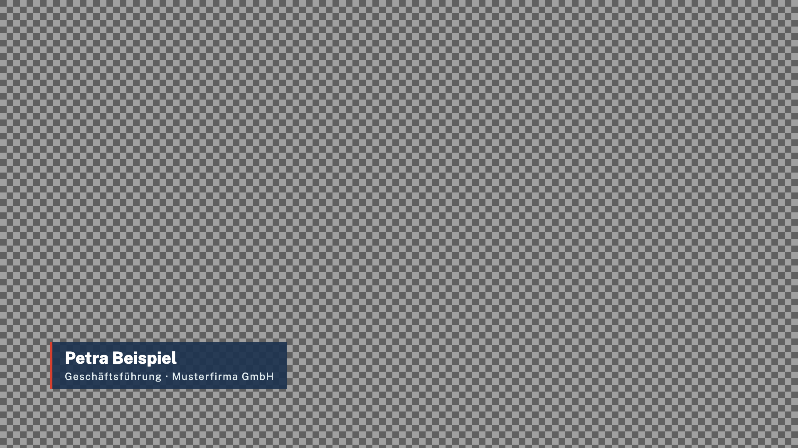

# LZ Vision Mixer Graphics (renderer)

Plays [EBU OGraf v1](https://github.com/ebu/ograf) graphics for LZ Vision Mixer's two graphics layers and sends them to the engine as frames with transparency. Electron app, runs without a visible output window; a small status window shows the engine connection, the layers (with an optional preview) and the graphics library.



## Run

```bash
npm install
npm start                                     # builds, then starts the renderer
npx electron . --engine ws://127.0.0.1:4195/renderer --graphics ~/Grafiken --graphics /Volumes/Show/Grafiken --hidden
```

| Flag | Meaning |
|---|---|
| `--engine <url>` | Engine WebSocket, default `ws://127.0.0.1:4195/renderer` |
| `--graphics <dir>` | Extra graphics folder, repeatable |
| `--hidden` | Start without the status window (tray icon only; on macOS also no Dock icon) |

The renderer connects on its own and keeps retrying (backoff up to 5 s) while the engine is not running. Closing the status window keeps it running; quit from the tray icon. Only one instance runs at a time.

## Graphics

Folders scanned, later ones win when two graphics share an id:

1. the bundled `graphics/` folder
2. `~/Documents/LZ Vision Mixer/Graphics` (created on first start; "Open folder" in the status window)
3. every `--graphics <dir>`

A graphic is a folder with an `*.ograf.json` manifest (subfolders are searched three levels deep; several manifests in one folder count as separate graphics, as OGraf allows). Graphics without `supportsRealTime` are skipped; the scan notes are listed in the status window. "Rescan" in the status window or a `rescan` from the engine re-reads the folders and reloads changed graphics on their next load.

Bundled, in the Lars Zumpe Medienproduktion design (Public Sans shipped locally, SIL OFL):

| id | What | Data |
|---|---|---|
| `lz-lower-third` | Name and function, optional third line. Plate (navy, tally edge) or open (line, tally dot) | `name`, `title`, `extra`, `position` left/right, `accentDot`, `style` plate/open |
| `lz-bug` | Corner label, optionally with the lz monogram or a tally square for LIVE | `text`, `corner`, `tally`, `monogram`, `plate` |
| `lz-title` | Title card inside the title-safe area | `kicker`, `headline`, `subline`, `backdrop` plate/full/none |
| `lz-lyrics` | Song lyrics from [lz-presenter](https://github.com/larszu/lz-presenter), one slide per step | see its manifest |

All of them take `updateAction` while on air (text cross-fades, the plate resizes; a change of position, style or backdrop goes out and in again) and honour `skipAnimation`.

## How it works

- After the engine's `hello`, one offscreen, transparent `BrowserWindow` per layer at the engine's format (`deviceScaleFactor` 1, paint rate = engine fps rounded up, at most 60).
- Each window runs an OGraf host page that imports the graphic's `main` module, defines it as a custom element and calls `load()` (schema defaults merged under the engine's data, `renderType: 'realtime'`, resolution and frame rate) before any action, and `dispose()` before removing it. Actions run in order; their results (`statusCode`, `currentStep`) become the `layer` messages to the engine. A graphic that does not resolve within 15 s (load 30 s) is reported as an error and the layer moves on.
- Graphics are served from an `ograf://` scheme, so module imports, `import.meta.url`, fetches and fonts work as on a web server.
- Every `paint` is converted to BGRA with straight alpha and written to the layer's frame port. The byte order and premultiplication are measured at startup by painting a known colour (macOS: BGRA, premultiplied). While the socket is backed up, older frames are skipped and the newest one is sent once it drains.
- After a (re)connect the frame socket gets the current picture at once (transparent when the layer is empty). A new `hello` clears both layers, since the engine starts a fresh session.

## Test

```bash
npm test                    # Vitest: protocol, library scan, pixel conversion, command line
npm run fake-engine -- --port 4295 --frame-ports 4298,4299
npx electron . --engine ws://127.0.0.1:4295/renderer
```

The fake engine (`scripts/fake-engine.mjs`) speaks the renderer protocol, counts frames and dumps a layer's last frame to PNG. Type commands on stdin or pass them with `--run "…; …"`:

```
load 1 lz-lower-third {"name":"Lars Zumpe","title":"Kamera"}
play 1
dump 1 /tmp/lt.png checker        # none | checker | grey
update 1 {"position":"right"}
stop 1
alpha 1                            # visible/transparent pixel counts and bounding box
stats
```

Development aids: `LZ_RENDERER_DEBUG=1` logs paints per second, conversion time and frame counts per layer; `LZ_RENDERER_PREVIEW=1` starts with the preview on; `LZ_RENDERER_STATUS_SHOT=<file.png>` saves a picture of the status window after four seconds.

## Build

```bash
npm run dist:mac      # universal dmg + zip
npm run dist:win      # NSIS installer + portable
npm run dist:linux    # AppImage + deb
```

## Status

Tested on macOS (Apple silicon): against the fake engine all four bundled graphics load, play, update on air and stop, transparency checked on dumped frames, around 50 frames per second during animations at 1080p50 (about 9 ms conversion per frame), reconnect after an engine restart; against the engine (1080p50) lower third and bug appear keyed over the programme in the multiview; the packaged arm64 app starts and finds its bundled graphics. Not yet tested: Windows and Linux, 2160p, the universal mac build.
